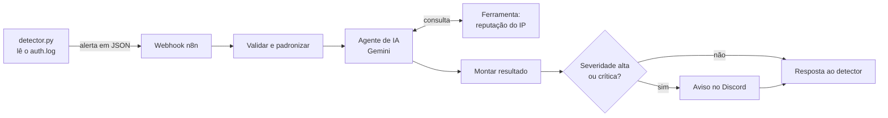

# Triagem de alertas SOC com IA (n8n + Python)

Automação que recebe alertas de força bruta em SSH, usa um agente de IA para fazer a triagem (como um analista de SOC nível 1) e avisa o time no Discord quando o caso é grave.

## Como funciona



1. O **detector.py** lê um log de autenticação do Linux e encontra IPs com 5 ou mais tentativas de login que falharam.
2. Cada alerta vai para um **webhook** do n8n (um endereço que recebe dados por HTTP).
3. O n8n confere os dados e passa o alerta para um **agente de IA**.
4. O agente consulta a reputação do IP com uma ferramenta, classifica a severidade, indica a técnica do **MITRE ATT&CK** e sugere ações.
5. Se a severidade for **alta** ou **crítica**, o n8n manda um aviso no Discord.
6. O detector recebe a triagem de volta e mostra no terminal.

## Tecnologias

- **n8n**: ferramenta de automação de fluxos (workflows)
- **Google Gemini**: modelo de linguagem (LLM) usado pelo agente, no plano gratuito
- **Python**: detector de força bruta, só com a biblioteca padrão
- **Discord**: canal de alertas

## Estrutura

```
detector/
  detector.py           # lê o log, detecta força bruta e envia ao n8n
  exemplo_auth.log      # log de exemplo para testes
workflow/
  triagem-alertas-soc.json   # fluxo do n8n (importar no n8n)
```

## Como rodar

**1. Subir o n8n** (precisa do Docker):

```
docker run -it --rm --name n8n -p 5678:5678 -v n8n_data:/home/node/.n8n docker.n8n.io/n8nio/n8n
```

Abra http://localhost:5678 e crie sua conta local.

**2. Importar o fluxo:** crie um workflow novo, clique nos três pontinhos (canto superior direito) > *Import from File* e escolha `workflow/triagem-alertas-soc.json`.

**3. Ligar a IA:** pegue uma chave gratuita em https://aistudio.google.com (*Get API key*). No n8n, abra o nó **Gemini**, crie a credencial colando a chave e escolha um modelo *Flash* na lista.

**4. Ligar o Discord:** no seu servidor do Discord, vá em *Editar canal > Integrações > Webhooks > Novo webhook* e copie a URL. No n8n, abra o nó **Avisar no Discord** e crie a credencial com essa URL.

**5. Testar no n8n:** clique em *Execute workflow*. O fluxo usa um alerta de exemplo e deve mandar um aviso no Discord.

**6. Testar com o Python:** publique o workflow (botão *Publish* ou de ativar) e rode:

```
python detector/detector.py detector/exemplo_auth.log --webhook http://localhost:5678/webhook/alerta-soc
```

Resultado esperado: 3 alertas. Dois são graves e vão para o Discord, um é médio e só volta para o terminal.

## O que cada nó faz

| Nó | Função |
| --- | --- |
| Receber alerta | Webhook que recebe o alerta do detector |
| Testar manualmente + Alerta de exemplo | Permitem testar sem o Python |
| Validar e padronizar | Confere o IP e limita o tamanho de cada campo |
| Analista SOC (IA) | Agente de IA que faz a triagem |
| Gemini | Modelo de linguagem usado pelo agente |
| consultar_reputacao_ip | Ferramenta do agente: diz se o IP é interno e se está na lista de bloqueio |
| Formato da resposta | Obriga a IA a responder sempre no mesmo formato JSON |
| Montar resultado | Junta alerta e análise e decide se escala |
| Severidade alta ou crítica? | Envia para o Discord ou não |
| Avisar no Discord | Manda a mensagem para o canal |
| Responder ao detector | Devolve a triagem para o Python |

## Cuidados de segurança

- **Validação de entrada:** alerta sem IP válido é recusado antes de chegar na IA.
- **Prompt injection** (texto escondido no log tentando dar ordens para a IA): o agente é instruído a tratar o conteúdo do log como dado, nunca como instrução, e só recebe um trecho curto do log.
- **Decisão por regra fixa:** quem decide se o alerta vai para o Discord é uma regra no código (severidade alta ou crítica), não a IA.
- **Segredos fora do código:** a chave do Gemini e a URL do Discord ficam nas credenciais do n8n. Elas não vão no JSON exportado nem para o GitHub.
- **Dados de exemplo seguros:** os IPs do log de exemplo são de faixas reservadas para documentação (RFC 5737).

## Limitações e próximos passos

- A lista de bloqueio é simulada. O próximo passo é consultar uma fonte real, como a AbuseIPDB.
- Detecta só força bruta em SSH. Dá para incluir varredura de portas (port scan).
- Salvar o histórico das triagens em uma planilha ou banco de dados.
